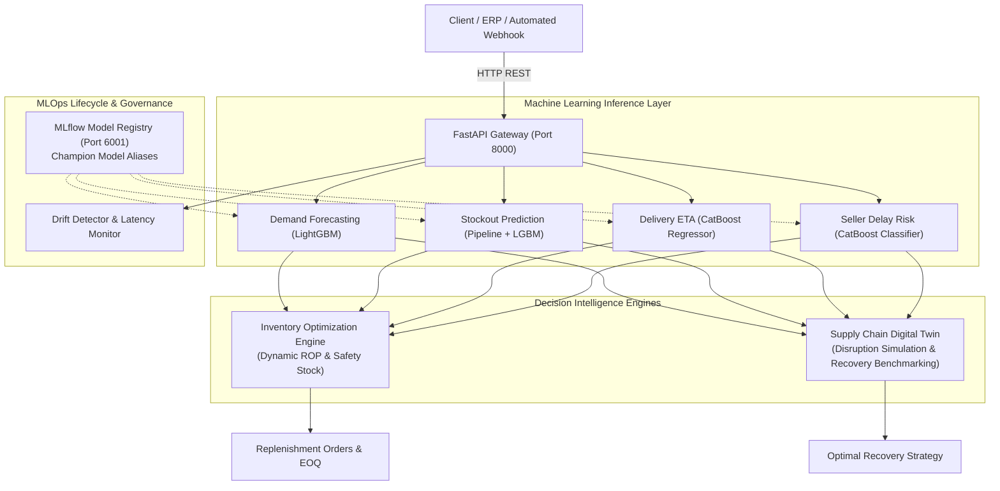

# ChainSight-AI
### Autonomous Supply Chain Resilience & Decision Intelligence Platform

[](https://github.com/AkshatSharma-05/ChainSight-AI/actions/workflows/ci.yaml)
[](https://www.python.org/downloads/release/python-3110/)
[](https://fastapi.tiangolo.com)
[](https://mlflow.org)
[](https://www.docker.com)

---

## 1. Project Overview

Modern retail, manufacturing, and third-party logistics organizations (such as Amazon, Walmart, and global supply chains) face persistent operational vulnerabilities:
- **Unexpected Demand Surges:** Local stock exhaustions causing lost revenue and customer churn.
- **Stockouts & Overstocking:** Carrying excessive inventory storage costs or facing sudden warehouse stockouts.
- **Carrier & Transit Delays:** Transit bottlenecks across multi-echelon distribution hubs.
- **Unreliable Suppliers / Sellers:** Delivery delays compounding across procurement schedules.

**ChainSight-AI** unifies **four pre-trained Machine Learning models** with **Operations Research inventory optimization** and a **Supply Chain Digital Twin** into an autonomous, containerized decision intelligence platform.

---

## 2. Platform Architecture



---

## 3. Four Integrated Machine Learning Models

All four models are pre-trained and serialized in standard `.joblib` format under `models/` (inference) and `chainsight_ai_complete_models/` (historical metadata archive):

| Model | Underlying Algorithm | Target Variable | Features | Source Dataset | Preprocessing in Artifact |
|---|---|---|---|---|---|
| **Demand Forecasting** | `LightGBMRegressor` | 7-day future unit sales | 12 features | Walmart M5 Forecasting | Converted to pandas `Categorical` (`dept_id`, `cat_id`) |
| **Stockout Prediction** | `sklearn.pipeline.Pipeline` (`ColumnTransformer` + `LGBMClassifier`) | Binary stockout within 7 days | 13 features | Simulated Warehouse Inventory | 100% self-contained in pipeline |
| **Delivery ETA** | `CatBoostRegressor` | Actual transit days | 7 features | Brazilian E-Commerce (Olist) | Native CatBoost categorical handling |
| **Seller Delay Risk** | `CatBoostClassifier` (Class balanced) | Binary delivery delay | 7 features | Brazilian E-Commerce (Olist) | Native CatBoost categorical handling |

---

## 4. Repository Structure

```
ChainSight-AI/
├── .github/
│   └── workflows/
│       ├── ci.yaml                          # GitHub Actions CI (test + docker build)
│       └── cd.yaml                          # GitHub Actions CD (publish to GHCR)
│
├── chainsight_ai_complete_models/           # Historical training archive & metadata
│   ├── delivery_eta/                        # CatBoost ETA model, metrics & feature schemas
│   ├── demand_forecasting/                  # LightGBM Demand model, metrics & training meta
│   ├── seller_risk/                         # CatBoost Seller Risk model & metrics
│   ├── stockout_prediction/                 # Stockout pipeline, feature importance & reports
│   └── all_models_comparison.csv            # Cross-model evaluation benchmark summary
│
├── models/                                  # Production inference model binaries
│   ├── delivery_eta/delivery_eta_model.joblib
│   ├── demand_forecasting/demand_model.joblib
│   ├── seller_risk/seller_risk_model.joblib
│   └── stockout_prediction/stockout_model.joblib
│
├── docs/                                    # Technical architecture & inspection reports
│   ├── architecture.md
│   ├── model_inspection_report.md
│   └── model_artifact_mapping.md
│
├── src/                                     # Core modular Python application
│   ├── api/
│   │   ├── routes.py                        # FastAPI route definitions
│   │   └── schemas.py                       # Pydantic request & response models
│   ├── services/
│   │   ├── base.py                          # Base model service with MLflow fallback
│   │   ├── demand_service.py                # Demand forecasting inference
│   │   ├── stockout_service.py              # Stockout prediction inference
│   │   ├── eta_service.py                   # Delivery ETA inference
│   │   ├── seller_service.py                # Seller delay risk inference
│   │   └── register_models_mlflow.py        # MLflow model registration script
│   ├── inventory/
│   │   └── engine.py                        # Inventory replenishment optimization (ROP, EOQ)
│   ├── simulation/
│   │   └── digital_twin.py                  # Disruption simulator & strategy benchmark
│   └── monitoring/
│       └── drift_detector.py                # Live inference monitoring & z-score drift test
│
├── tests/
│   └── test_api.py                          # Complete automated test suite (14 test cases)
│
├── Dockerfile                               # Production Dockerfile (Python 3.11-slim)
├── docker-compose.yml                       # Multi-container orchestration (API + MLflow)
├── .dockerignore
├── .gitignore
├── pytest.ini
├── requirements.txt
├── main.py                                  # Application entry point
└── README.md
```

---

## 5. Quickstart Guide (Universal Setup)

You can run ChainSight-AI on any operating system (**Windows, macOS, or Linux**) using either **Docker Compose** (fastest, zero dependencies) or a **local Python environment**.

### Prerequisites
- [Git](https://git-scm.com/downloads)
- [Python 3.11](https://www.python.org/downloads/) *(only if running locally without Docker)*
- [Docker Desktop](https://www.docker.com/products/docker-desktop/) *(only if running in containers)*

---

### Option A: Run with Docker Compose (Recommended for Any System)

No local Python installation or package setup required:

```bash
# 1. Clone the repository
git clone https://github.com/AkshatSharma-05/ChainSight-AI.git
cd ChainSight-AI

# 2. Build and start both FastAPI and MLflow in the background
docker compose up --build -d
```

Once started:
- 🌐 **Interactive Swagger UI:** [http://localhost:8000/docs](http://localhost:8000/docs)
- 📊 **MLflow Tracking UI:** [http://localhost:6001](http://localhost:6001)
- 🩺 **Health Check:** [http://localhost:8000/health](http://localhost:8000/health)

To stop services:
```bash
docker compose down
```

---

### Option B: Local Python Environment Setup

#### 1. Clone & Enter Repository
```bash
git clone https://github.com/AkshatSharma-05/ChainSight-AI.git
cd ChainSight-AI
```

#### 2. Create & Activate Virtual Environment

**On Windows (PowerShell):**
```powershell
python -m venv venv
.\venv\Scripts\Activate.ps1
```

**On Windows (Command Prompt `cmd`):**
```cmd
python -m venv venv
venv\Scripts\activate.bat
```

**On macOS / Linux (bash/zsh):**
```bash
python3 -m venv venv
source venv/bin/activate
```

#### 3. Install Dependencies
```bash
pip install --upgrade pip
pip install -r requirements.txt
```

#### 4. Register Models in MLflow (Experiment Tracking & Model Registry)
```bash
python src/services/register_models_mlflow.py
```
*This imports all 4 models into local SQLite storage (`mlflow.db`), logs historical evaluation metrics and hyperparameters, and assigns the `@champion` alias to each model.*

#### 5. Run Automated Tests
```bash
python -m pytest tests/test_api.py -v
```
*Runs the 14 automated tests covering health checks, all four prediction endpoints, inventory optimization, disruption simulation, and drift monitoring.*

#### 6. Launch the FastAPI Server
```bash
uvicorn main:app --host 0.0.0.0 --port 8000 --reload
```
*Or directly via Python:*
```bash
python main.py
```

Access the interactive API documentation at: **[http://localhost:8000/docs](http://localhost:8000/docs)**

---

## 6. API Documentation & Sample Requests

All endpoints accept standard JSON payloads. You can use standard `curl` (cross-platform) or PowerShell `Invoke-RestMethod`.

### 1. Demand Forecasting (`POST /predict/demand`)

Forecasts product unit sales for the next 7 days using the LightGBM Regressor.

**cURL (macOS / Linux / Windows):**
```bash
curl -X POST "http://localhost:8000/predict/demand" \
  -H "Content-Type: application/json" \
  -d '{
    "wday": 1, "month": 5, "year": 2016, "sell_price": 8.50,
    "lag_7": 12.0, "lag_14": 10.0, "lag_28": 15.0,
    "rolling_mean_7": 11.2, "rolling_mean_28": 13.5, "rolling_std_7": 2.1,
    "dept_id": "FOODS_1", "cat_id": "FOODS"
  }'
```

**PowerShell:**
```powershell
Invoke-RestMethod -Uri "http://localhost:8000/predict/demand" -Method Post -ContentType "application/json" -Body '{
  "wday": 1, "month": 5, "year": 2016, "sell_price": 8.50,
  "lag_7": 12.0, "lag_14": 10.0, "lag_28": 15.0,
  "rolling_mean_7": 11.2, "rolling_mean_28": 13.5, "rolling_std_7": 2.1,
  "dept_id": "FOODS_1", "cat_id": "FOODS"
}' | ConvertTo-Json
```

**Sample Response:**
```json
{
  "model_name": "DemandForecastingModel",
  "version": "1.0.0",
  "source": "local_joblib",
  "prediction": 13.35,
  "unit": "units",
  "horizon": "next_7_days",
  "timestamp": "2026-11-19T17:01:55.615148+00:00",
  "latency_ms": 15.2,
  "metadata": {
    "algorithm": "LightGBMRegressor",
    "features_used": 12,
    "target_definition": "Target unit sales for next 7 days"
  }
}
```

---

### 2. Stockout Prediction (`POST /predict/stockout`)

Predicts the probability of a warehouse stockout within 7 days using the Scikit-learn Pipeline with calibrated decision threshold ($F_1$ threshold `0.4556`).

**cURL:**
```bash
curl -X POST "http://localhost:8000/predict/stockout" \
  -H "Content-Type: application/json" \
  -d '{
    "opening_stock": 50, "received_stock": 10, "avg_daily_demand_7d": 8.0,
    "avg_daily_demand_30d": 7.5, "demand_std_7d": 1.5, "inventory_coverage_days": 6.25,
    "supplier_avg_lead_time": 5, "supplier_reliability": 0.95, "warehouse_utilization_pct": 75.0,
    "warehouse_id": "WH_001", "product_category": "Electronics", "day_of_week": 2, "month": 5
  }'
```

**Sample Response:**
```json
{
  "model_name": "StockoutPredictionModel",
  "version": "1.0.0",
  "prediction": 1,
  "prediction_label": "Stockout Risk Detected",
  "stockout_probability": 0.544,
  "no_stockout_probability": 0.456,
  "risk_severity": "HIGH",
  "calibrated_threshold": 0.4556,
  "horizon": "next_7_days"
}
```

---

### 3. Delivery ETA Prediction (`POST /predict/delivery-eta`)

Predicts carrier transit duration in days using CatBoost Regressor.

**cURL:**
```bash
curl -X POST "http://localhost:8000/predict/delivery-eta" \
  -H "Content-Type: application/json" \
  -d '{
    "price": 45.0, "freight_value": 12.5, "product_weight_g": 500.0,
    "product_category_name": "beleza_saude", "seller_state": "SP",
    "customer_state": "RJ", "seller_delivery_count": 15
  }'
```

**Sample Response:**
```json
{
  "model_name": "DeliveryETAModel",
  "prediction": 12.3,
  "unit": "days",
  "latency_ms": 27.6,
  "metadata": {
    "algorithm": "CatBoostRegressor",
    "training_mae": 6.16
  }
}
```

---

### 4. Seller Delay Risk (`POST /predict/seller-risk`)

Estimates supplier reliability and probability of shipping delays using CatBoost Classifier.

**cURL:**
```bash
curl -X POST "http://localhost:8000/predict/seller-risk" \
  -H "Content-Type: application/json" \
  -d '{
    "price": 45.0, "freight_value": 12.5, "product_weight_g": 500.0,
    "product_category_name": "beleza_saude", "seller_state": "SP",
    "customer_state": "RJ", "seller_delivery_count": 15
  }'
```

**Sample Response:**
```json
{
  "model_name": "SellerRiskModel",
  "prediction": 0,
  "prediction_label": "Normal Risk",
  "delay_probability": 0.4499,
  "on_time_probability": 0.5501,
  "risk_level": "MEDIUM"
}
```

---

### 5. Inventory Replenishment Optimization (`POST /inventory/recommend`)

Combines outputs from all 4 ML models with Operations Research replenishment formulas.

**cURL:**
```bash
curl -X POST "http://localhost:8000/inventory/recommend" \
  -H "Content-Type: application/json" \
  -d '{
    "current_stock": 35,
    "unit_price": 25.0,
    "predicted_7d_demand": 85.0,
    "stockout_prob": 0.65,
    "delivery_eta_days": 6.5,
    "seller_delayed_prob": 0.40,
    "daily_demand_std": 2.5
  }'
```

**Sample Response:**
```json
{
  "optimization_metrics": {
    "current_stock": 35,
    "safety_stock_units": 12,
    "reorder_point_units": 107,
    "economic_order_qty_eoq": 95,
    "recommended_reorder_qty": 298
  },
  "recommendation": {
    "action": "PLACE_PURCHASE_ORDER",
    "summary": "Stock level (35) is at or below ROP (107). Order 298 units immediately.",
    "urgency": "HIGH"
  }
}
```

---

### 6. Digital Twin Disruption Simulation (`POST /simulation/disrupt`)

Simulates supplier delays and demand surge shocks, automatically benchmarking 4 recovery strategies.

**cURL:**
```bash
curl -X POST "http://localhost:8000/simulation/disrupt" \
  -H "Content-Type: application/json" \
  -d '{
    "current_inventory": 100,
    "daily_demand": 20.0,
    "supplier_lead_time_days": 5,
    "unit_price": 50.0,
    "disruption_lead_time_delay_days": 6,
    "disruption_demand_surge_pct": 50.0,
    "lost_sale_penalty_multiplier": 1.5
  }'
```

**Sample Response:**
```json
{
  "simulation_scenario": {
    "supplier_delay_days": 6,
    "demand_surge_percentage": 50.0,
    "disrupted_daily_demand": 30.0,
    "unmitigated_shortage_units": 230
  },
  "recommended_recovery_action": {
    "recommended_strategy_id": "ALTERNATIVE_SUPPLIER",
    "name": "Order from Alternative Supplier",
    "reason": "Minimizes total disruption cost to $2875.00.",
    "cost_saving_vs_do_nothing": 14375.0
  }
}
```

---

### 7. Data Drift & System Monitoring (`GET /monitoring/status`)

Calculates live z-scores across incoming feature distributions against training baseline distributions.

**cURL:**
```bash
curl -X GET "http://localhost:8000/monitoring/status"
```

---

## 7. Standalone Docker Run Commands

If running Docker without Docker Compose:

```bash
# 1. Build Docker image
docker build -t chainsight-ai .

# 2. Run container
docker run -d -p 8000:8000 --name chainsight-container chainsight-ai

# 3. Check health endpoint
curl http://localhost:8000/health

# 4. Stop and remove container
docker stop chainsight-container
docker rm chainsight-container
```

---

## 8. Continuous Integration & Continuous Delivery (CI/CD)

The repository includes GitHub Actions workflows under `.github/workflows/`:
- **`ci.yaml` (Pull Requests):** Automatically spins up Ubuntu, sets up Python 3.11, runs all 14 tests, and verifies that the Docker image builds cleanly.
- **`cd.yaml` (Push to `main`):** Executes automated tests, builds the production container, and publishes it to the GitHub Container Registry (`ghcr.io/akshatsharma-05/chainsight-ai:latest`).

---

## 9. Academic Acceptance & Verification Checklist

- [x] All 4 pre-trained models integrated (`DemandForecastingModel`, `StockoutPredictionModel`, `DeliveryETAModel`, `SellerRiskModel`).
- [x] Preprocessing requirements accurately reproduced for inference.
- [x] Strict input schema validation with Pydantic v2.
- [x] All 14 automated unit & integration tests passing.
- [x] MLflow experiment tracking and Model Registry configured with `@champion` aliases.
- [x] Multi-container Docker Compose with persistent SQLite and artifact volumes.
- [x] Inventory replenishment optimization engine implemented (ROP, Safety Stock, EOQ).
- [x] Supply Chain Digital Twin disruption simulator implemented with strategy benchmarking.
- [x] Real-time inference monitoring and statistical z-score data drift detection implemented.
- [x] CI/CD workflows configured for GitHub Container Registry publishing.
- [x] Platform-agnostic documentation for Windows, macOS, and Linux.
