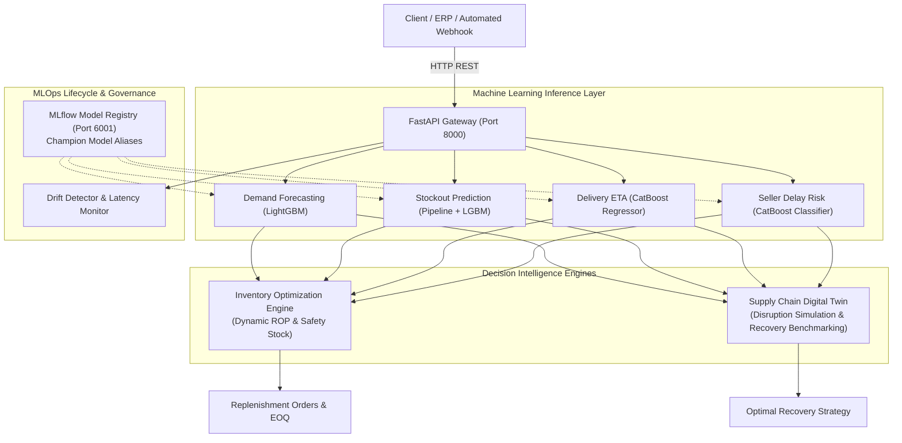

# ChainSight-AI
### Autonomous Supply Chain Resilience & Decision Intelligence Platform

[](https://github.com/AkshatSharma-05/ChainSight-AI/actions/workflows/ci.yaml)
[](https://www.python.org/downloads/release/python-3110/)
[](https://fastapi.tiangolo.com)
[](https://mlflow.org)
[](https://www.docker.com)

---

## 1. Project Overview

Large retail and manufacturing organizations (such as Amazon, Walmart, and global logistics providers) face critical operational vulnerabilities:
- **Unexpected Demand Surges:** Outstripping localized stock and leading to lost sales.
- **Stockouts & Overstocking:** Carrying excessive inventory costs or facing stock exhaustion.
- **Carrier & Transit Delays:** Bottlenecks across fulfillment hubs.
- **Unreliable Suppliers / Sellers:** Causing cascading downstream delays.

**ChainSight-AI** solves this challenge by unifying **four trained Machine Learning models** with **Operations Research optimization** and a **Supply Chain Digital Twin** into an end-to-end autonomous decision intelligence platform.

---

## 2. Platform Architecture



---

## 3. Four Integrated Machine Learning Models

| Model | Underlying Algorithm | Target Variable | Features | Source Dataset | Preprocessing in Artifact |
|---|---|---|---|---|---|
| **Demand Forecasting** | `LightGBMRegressor` | 7-day future unit sales | 12 features | Walmart M5 Forecasting | Converted to pandas Categorical |
| **Stockout Prediction** | `sklearn.pipeline.Pipeline` (`ColumnTransformer` + `LGBMClassifier`) | Binary stockout within 7 days | 13 features | Simulated Warehouse Inventory | 100% self-contained in pipeline |
| **Delivery ETA** | `CatBoostRegressor` | Actual transit days | 7 features | Brazilian E-Commerce (Olist) | Native CatBoost string handling |
| **Seller Delay Risk** | `CatBoostClassifier` (Class balanced) | Binary delivery delay | 7 features | Brazilian E-Commerce (Olist) | Native CatBoost string handling |

---

## 4. Repository Structure

```
ChainSight-AI/
├── .github/
│   └── workflows/
│       ├── ci.yaml                          # GitHub Actions CI (test + docker build)
│       └── cd.yaml                          # GitHub Actions CD (publish to GHCR)
│
├── chainsight_ai_complete_models/           # Historical training archive & metadata
│   ├── delivery_eta/
│   ├── demand_forecasting/
│   ├── seller_risk/
│   ├── stockout_prediction/
│   └── all_models_comparison.csv
│
├── models/                                  # Production inference artifacts
│   ├── delivery_eta/delivery_eta_model.joblib
│   ├── demand_forecasting/demand_model.joblib
│   ├── seller_risk/seller_risk_model.joblib
│   └── stockout_prediction/stockout_model.joblib
│
├── public_datasets/                         # Raw training datasets (ignored by Git/Docker)
│   ├── m5/
│   └── olist/
│
├── docs/                                    # Technical architecture & inspection reports
│   ├── architecture.md
│   ├── model_inspection_report.md
│   └── model_artifact_mapping.md
│
├── src/                                     # Core modular Python application
│   ├── api/
│   │   ├── routes.py                        # FastAPI route definitions
│   │   └── schemas.py                       # Pydantic request & response models
│   ├── services/
│   │   ├── base.py                          # Base model service with MLflow fallback
│   │   ├── demand_service.py                # Demand forecasting inference
│   │   ├── stockout_service.py              # Stockout prediction inference
│   │   ├── eta_service.py                   # Delivery ETA inference
│   │   ├── seller_service.py                # Seller delay risk inference
│   │   └── register_models_mlflow.py        # MLflow model registration script
│   ├── inventory/
│   │   └── engine.py                        # Inventory replenishment optimization (ROP, EOQ)
│   ├── simulation/
│   │   └── digital_twin.py                  # Disruption simulator & strategy benchmark
│   └── monitoring/
│       └── drift_detector.py                # Live inference monitoring & z-score drift test
│
├── tests/
│   └── test_api.py                          # Complete automated test suite (14 test cases)
│
├── Dockerfile                               # Production Dockerfile
├── docker-compose.yml                       # Multi-container orchestration (API + MLflow)
├── .dockerignore
├── .gitignore
├── pytest.ini
├── requirements.txt
├── main.py                                  # Application entry point
└── README.md
```

---

## 5. Local Setup & Installation (Windows PowerShell)

### Prerequisites
- Python 3.11 installed
- Git installed
- Docker Desktop installed (optional, for containerization)

### Step 1: Clone Repository & Create Virtual Environment
Open PowerShell:
```powershell
# Navigate to workspace
cd c:\Users\gamin\OneDrive\Desktop\AI_Elective\MLOPS\ChainSight-AI

# Create virtual environment
python -m venv venv

# Activate virtual environment
.\venv\Scripts\Activate.ps1
```

### Step 2: Install Dependencies
```powershell
pip install --upgrade pip
pip install -r requirements.txt
```

### Step 3: Register Models in MLflow (Experiment Tracking & Registry)
```powershell
python src/services/register_models_mlflow.py
```
This logs historical runs, parameters, metrics, artifacts, and assigns the `@champion` alias to all four models.

### Step 4: Run Automated Tests
```powershell
python -m pytest tests/test_api.py -v
```
All 14 tests covering system health, all four models, inventory optimization, simulation, and data drift will pass.

### Step 5: Start FastAPI Application
```powershell
python main.py
```
Or with Uvicorn:
```powershell
uvicorn main:app --host 127.0.0.1 --port 8000 --reload
```

---

## 6. Interactive Swagger Documentation
Open your web browser and visit:
👉 **[http://127.0.0.1:8000/docs](http://127.0.0.1:8000/docs)**

---

## 7. Sample API Requests & Responses

### 1. Demand Forecasting (`POST /predict/demand`)
```powershell
Invoke-RestMethod -Uri "http://127.0.0.1:8000/predict/demand" -Method Post -ContentType "application/json" -Body '{
  "wday": 1, "month": 5, "year": 2016, "sell_price": 8.50,
  "lag_7": 12.0, "lag_14": 10.0, "lag_28": 15.0,
  "rolling_mean_7": 11.2, "rolling_mean_28": 13.5, "rolling_std_7": 2.1,
  "dept_id": "FOODS_1", "cat_id": "FOODS"
}' | ConvertTo-Json
```
**Response:**
```json
{
  "model_name": "DemandForecastingModel",
  "version": "1.0.0",
  "source": "local_joblib",
  "prediction": 13.35,
  "unit": "units",
  "horizon": "next_7_days",
  "timestamp": "2026-11-19T16:44:33.154689+00:00",
  "latency_ms": 15.2,
  "metadata": {
    "algorithm": "LightGBMRegressor",
    "features_used": 12,
    "target_definition": "Target unit sales for next 7 days"
  }
}
```

### 2. Stockout Prediction (`POST /predict/stockout`)
```powershell
Invoke-RestMethod -Uri "http://127.0.0.1:8000/predict/stockout" -Method Post -ContentType "application/json" -Body '{
  "opening_stock": 50, "received_stock": 10, "avg_daily_demand_7d": 8.0,
  "avg_daily_demand_30d": 7.5, "demand_std_7d": 1.5, "inventory_coverage_days": 6.25,
  "supplier_avg_lead_time": 5, "supplier_reliability": 0.95, "warehouse_utilization_pct": 75.0,
  "warehouse_id": "WH_001", "product_category": "Electronics", "day_of_week": 2, "month": 5
}' | ConvertTo-Json
```
**Response:**
```json
{
  "model_name": "StockoutPredictionModel",
  "prediction": 1,
  "prediction_label": "Stockout Risk Detected",
  "stockout_probability": 0.544,
  "risk_severity": "HIGH",
  "calibrated_threshold": 0.4556
}
```

### 3. Inventory Optimization Recommendation (`POST /inventory/recommend`)
```powershell
Invoke-RestMethod -Uri "http://127.0.0.1:8000/inventory/recommend" -Method Post -ContentType "application/json" -Body '{
  "current_stock": 35,
  "unit_price": 25.0,
  "predicted_7d_demand": 85.0,
  "stockout_prob": 0.65,
  "delivery_eta_days": 6.5,
  "seller_delayed_prob": 0.40,
  "daily_demand_std": 2.5
}' | ConvertTo-Json
```
**Response:**
```json
{
  "optimization_metrics": {
    "current_stock": 35,
    "safety_stock_units": 12,
    "reorder_point_units": 110,
    "economic_order_qty_eoq": 95,
    "recommended_reorder_qty": 160
  },
  "recommendation": {
    "action": "PLACE_PURCHASE_ORDER",
    "summary": "Stock level (35) is at or below ROP (110). Order 160 units immediately.",
    "urgency": "HIGH"
  }
}
```

### 4. Supply Chain Digital Twin Disruption Simulation (`POST /simulation/disrupt`)
```powershell
Invoke-RestMethod -Uri "http://127.0.0.1:8000/simulation/disrupt" -Method Post -ContentType "application/json" -Body '{
  "current_inventory": 100,
  "daily_demand": 20.0,
  "supplier_lead_time_days": 5,
  "unit_price": 50.0,
  "disruption_lead_time_delay_days": 6,
  "disruption_demand_surge_pct": 50.0,
  "lost_sale_penalty_multiplier": 1.5
}' | ConvertTo-Json
```
**Response:**
```json
{
  "simulation_scenario": {
    "supplier_delay_days": 6,
    "demand_surge_percentage": 50.0,
    "disrupted_daily_demand": 30.0,
    "unmitigated_shortage_units": 230
  },
  "recommended_recovery_action": {
    "recommended_strategy_id": "EXPEDITED_FREIGHT",
    "name": "Expedited Air Shipping",
    "reason": "Minimizes total disruption cost to $250.00.",
    "cost_saving_vs_do_nothing": 17000.0
  }
}
```

### 5. Monitoring & Drift Detection (`GET /monitoring/status`)
```powershell
Invoke-RestMethod -Uri "http://127.0.0.1:8000/monitoring/status" -Method Get | ConvertTo-Json
```

---

## 8. Docker & Docker Compose

### Run with Docker:
```powershell
# Build image
docker build -t chainsight-ai .

# Run container
docker run -d -p 8000:8000 --name chainsight-container chainsight-ai

# Check health
curl http://localhost:8000/health
```

### Run with Docker Compose (FastAPI + MLflow Tracking Server):
```powershell
# Start both services
docker compose up --build -d

# Inspect running services
docker compose ps

# View MLflow UI at: http://localhost:6001
# View FastAPI at: http://localhost:8000/docs

# Stop services
docker compose down
```

---

## 9. CI/CD & GitHub Container Registry (GHCR)

The repository includes GitHub Actions workflows under `.github/workflows/`:
1. **`ci.yaml` (Pull Requests):** Installs Python 3.11, runs all 14 tests with `pytest`, and validates `docker build`.
2. **`cd.yaml` (Pushes to `main`):** Runs the test suite, builds the Docker image, and automatically publishes it to GitHub Container Registry (`ghcr.io`).

---

## 10. Academic Acceptance Checklist

- [x] All 4 existing trained models deserialized, verified, and mapped.
- [x] Input schemas match real feature requirements and categorical encodings.
- [x] Preprocessing requirements accurately reproduced (pandas categorical for LightGBM, pipeline for Stockout, native for CatBoost).
- [x] FastAPI REST endpoints implemented and tested with 200 OK outputs.
- [x] Automated test suite (`pytest`) with 14 unit, integration, and edge-case tests.
- [x] MLflow experiment tracking integrated with 4 separate experiments.
- [x] MLflow Model Registry configured with `@champion` aliases for each model.
- [x] Inventory Optimization Engine implemented (Dynamic ROP, Safety Stock, EOQ).
- [x] Supply Chain Digital Twin Disruption Simulation implemented with multi-strategy benchmarking.
- [x] Live inference monitoring and statistical z-score data drift detection implemented.
- [x] Multi-container Docker Compose with persistent SQLite and artifact volumes.
- [x] CI/CD workflows configured for automated test validation and GHCR publishing.
