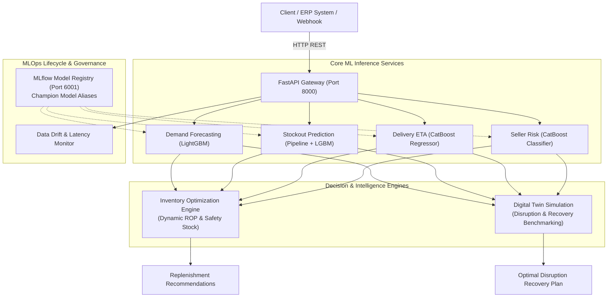

# ChainSight-AI: Architecture & System Design

**Platform:** Autonomous Supply Chain Resilience & Decision Intelligence Platform  
**Target:** Academic B.Tech Project & Production MLOps Blueprint  

---

## 1. System Overview

ChainSight-AI is a multi-model decision intelligence platform designed to address supply chain volatility across manufacturing, e-commerce, and retail distribution networks.

---

## 2. Core Components

### 2.1 Model Serving Layer (`src/services/`)
- **Demand Forecasting (`DemandForecastingService`):** Predicts 7-day future unit sales using LightGBM regressor trained on Walmart M5 retail sales.
- **Stockout Prediction (`StockoutPredictionService`):** Scikit-learn Pipeline with embedded `StandardScaler` and `OneHotEncoder` computing 7-day stockout probabilities calibrated at $F_1$ threshold `0.4556`.
- **Delivery ETA (`DeliveryETAService`):** CatBoost regressor computing shipment transit duration in days.
- **Seller Risk (`SellerRiskService`):** CatBoost classifier estimating seller-associated shipping delay probabilities with balanced class weighting.

### 2.2 Inventory Optimization Engine (`src/inventory/`)
Combines predictions from all four models using classic Operations Research formulations:
- **Dynamic Safety Stock ($SS$):** $SS = Z \cdot \sigma_d \cdot \sqrt{L_{effective}}$ where $L_{effective}$ is the ETA scaled by the seller delay probability.
- **Dynamic Reorder Point ($ROP$):** $ROP = (\bar{d} \cdot L_{effective}) + SS$
- **Economic Order Quantity ($EOQ$):** $EOQ = \sqrt{\frac{2 \cdot D_{annual} \cdot S}{H}}$

### 2.3 Supply Chain Digital Twin (`src/simulation/`)
Enables "what-if" disruption simulation (e.g., 5-day supplier delay + 40% demand surge) and automatically benchmarks four recovery strategies:
1. Continue with Existing Supplier (absorb delay)
2. Expedited Secondary Supplier
3. Priority Air Freight
4. Regional Warehouse Cross-Dock Transfer

Recommends the strategy yielding lowest total disruption cost.

### 2.4 Monitoring & Drift Detection (`src/monitoring/`)
Maintains sliding-window inference statistics and performs two-sample z-score tests comparing live streaming inputs against baseline training distributions.

### 2.5 MLflow Tracking & Registry
Tracks experiments, metrics, tags, parameters, and registers all models with `@champion` aliases on SQLite storage.
